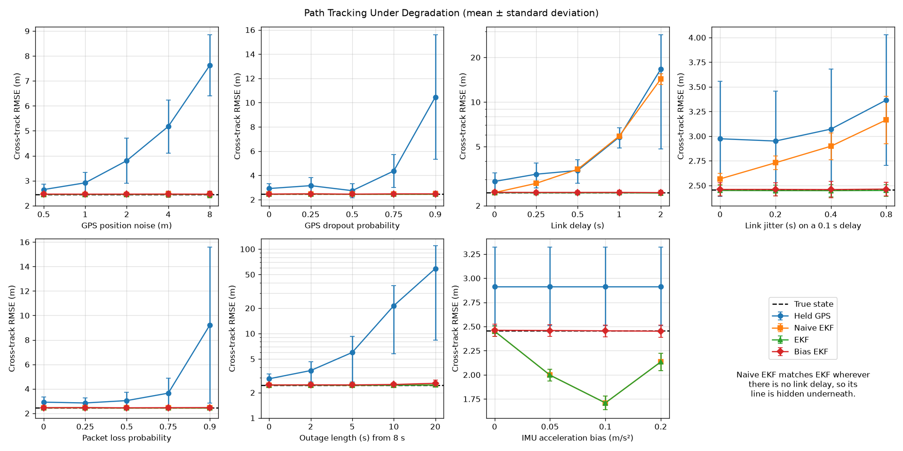
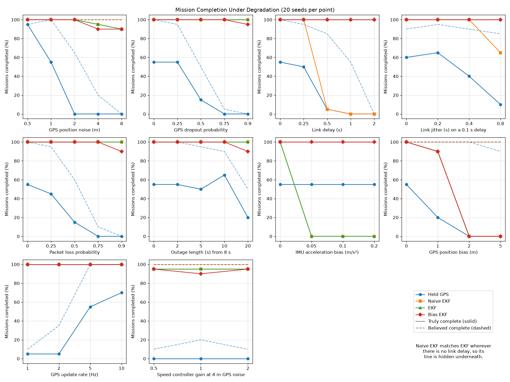
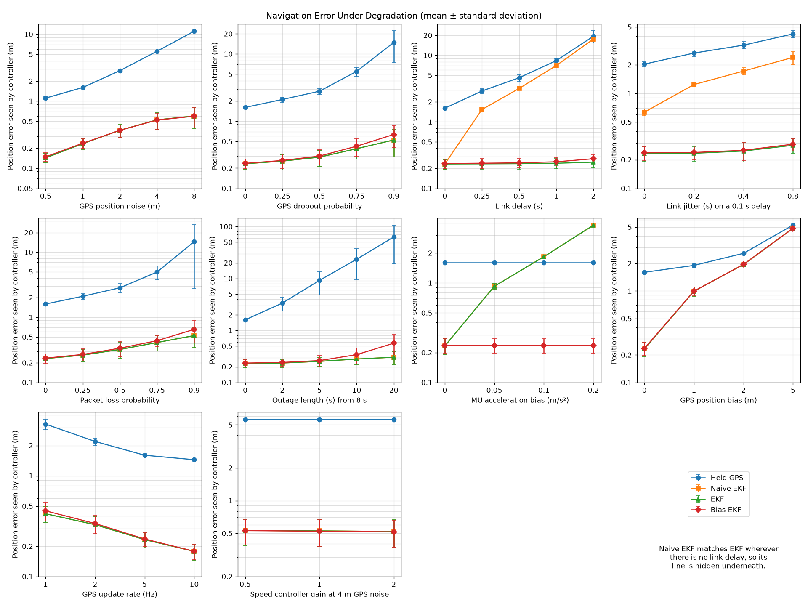

# Robust Autonomous Flight

A Python-based simulation and research framework for investigating robust autonomous flight under uncertainty.

The project is being developed as a research-oriented side project alongside an application to graduate study in aerospace systems and control.

---

## Research Direction

The long-term focus is:

> **Guidance, Navigation, Estimation and Control of Autonomous Aerospace Systems**

The initial research question is:

> **How do sensor uncertainty and communication degradation affect autonomous aircraft state estimation and trajectory tracking, and to what extent can feedback control and state estimation mitigate these effects?**

The project will progressively introduce realistic sources of uncertainty into an autonomous aircraft simulation and evaluate how different estimation and control strategies respond.

---

## Key Findings

From 2,640 simulated flights of a 50 m square mission: seven kinds of degradation, each at four or five levels, four navigation options, and 20 random seeds per condition. Every result reproduces exactly from the committed code.

1. **Without state estimation, moderate degradation stops the mission.** Steering on the latest GPS fix, mission completion falls to 65% with 2 m of GPS noise, 50% with half the fixes dropped, 55% with a 1 s link delay, 60% with half the packets lost, and 50% after a 20 s outage.
2. **With an Extended Kalman Filter (EKF), every mission completes.** All 1,980 EKF flights finished. Away from IMU bias, the delay-compensated EKF tracked the path within 0.03 m of an aircraft that knows its true state, up to 8 m of GPS noise, 90% of fixes or packets lost, or a 20 s outage.
3. **Link delay is what defeats a naive filter, and compensating for it removes the penalty.** Applying late fixes as if they were current, a 1 s delay raises the EKF's position error from 0.23 m to 7.0 m and makes it badly overconfident. Applying each fix at the moment it was taken keeps the error at 0.24 m at 1 s and 0.25 m at 2 s, with consistent uncertainty.
4. **IMU bias breaks the standard EKF, and estimating the bias fixes it.** A 0.2 m/s² accelerometer bias pushes the four-state EKF's error to 3.8 m. Two extra filter states that estimate the biases hold it at 0.24 m at every bias level tested, at a small cost when GPS is scarce.
5. **Waypoint capture must be sized against navigation error.** Steering on raw GPS with 1 m of noise and a 1 m capture radius, the aircraft misses waypoints and loops back, and missions take 44% longer. A 2 m radius removes the extra time.

These findings come from a planar kinematic model with simulated sensors on a single mission. They show how the effects behave and compare, not validated aircraft performance.



---

## Current Scope

The simulation currently models a simplified planar aircraft with four states:

```text
state = [px, py, v, ψ]
```

where:

- `px` — x-position
- `py` — y-position
- `v` — speed
- `ψ` — heading

The control input is:

```text
control = [a, r]
```

where:

- `a` — acceleration
- `r` — heading rate

The aircraft dynamics are:

```text
dpx/dt = v cos(ψ)
dpy/dt = v sin(ψ)
dv/dt  = a
dψ/dt  = r
```

The current aircraft model uses forward Euler integration.

This is intentionally a simplified model, so that the effects of sensing, communication and estimation can be isolated and measured before physical complexity is added.

---

## Project Architecture

The current source tree is:

```text
src/
└── robust_flight/
    ├── __init__.py
    │
    ├── dynamics/
    │   ├── __init__.py
    │   ├── actuator.py
    │   └── aircraft.py
    │
    ├── simulation/
    │   ├── __init__.py
    │   └── engine.py
    │
    ├── sensors/
    │   ├── __init__.py
    │   ├── gps.py
    │   └── imu.py
    │
    ├── communication/
    │   ├── __init__.py
    │   └── link.py
    │
    ├── estimation/
    │   ├── __init__.py
    │   └── ekf.py
    │
    ├── guidance/
    │   ├── __init__.py
    │   └── waypoints.py
    │
    ├── control/
    │   ├── __init__.py
    │   ├── heading.py
    │   └── speed.py
    │
    ├── mission/
    │   ├── __init__.py
    │   └── mission.py
    │
    └── experiments/
        ├── __init__.py
        ├── runner.py
        ├── basic_flight.py
        ├── actuator_authority.py
        ├── feedback_comparison.py
        ├── robustness.py
        └── robustness_plots.py

tests/
├── test_waypoints.py
├── test_engine.py
├── test_sensors.py
├── test_link.py
├── test_ekf.py
└── test_runner.py

results/
├── robustness.csv
├── robustness_completion.png
├── robustness_tracking.png
└── robustness_estimation.png
```

### Design Principles

The project is intentionally being developed with separation between:

- aircraft dynamics
- simulation execution
- sensing
- communication
- state estimation
- guidance
- control
- mission management
- experiments

This allows individual components to evolve without turning the simulation into a single monolithic script.

---

## Getting Started

Create a virtual environment:

```bash
python3 -m venv .venv
```

Activate the virtual environment.

**macOS / Linux**

```bash
source .venv/bin/activate
```

**Windows**

```powershell
.venv\Scripts\Activate.ps1
```

Install the project and development dependencies:

```bash
pip install -e ".[dev]"
```

Run the speed controller gain experiment:

```bash
python -m robust_flight.experiments.basic_flight
```

It prints metrics for each gain and a comparison table, then opens two plots:

- desired vs. actual speed over time
- speed tracking error over time

Run the actuator authority experiment:

```bash
python -m robust_flight.experiments.actuator_authority
```

It prints an acceleration-limit sweep and a turn-rate-limit sweep, then opens a plot of the aircraft trajectories for each turn-rate limit.

Compare steering on the true state, the latest GPS fix and the EKF estimate over 20 seeds:

```bash
python -m robust_flight.experiments.feedback_comparison
```

Run the robustness sweep, which flies all 2,640 cases in parallel and saves `results/robustness.csv` (about three minutes on 12 cores):

```bash
python -m robust_flight.experiments.robustness
```

Draw the robustness figures from the saved results, without rerunning the sweep:

```bash
python -m robust_flight.experiments.robustness_plots
```

Each plot window must be closed before the next one opens.

Run the test suite (46 tests, about 10 seconds):

```bash
pytest
```

---

## Aircraft Dynamics

The `Aircraft` class currently owns the aircraft state and dynamics.

The state is represented as:

```python
state = [px, py, v, psi]
```

The dynamics function computes the state derivative from the current state and control input.

The simulation uses forward Euler integration:

```python
state_next = state + state_derivative * dt
```

The simulation loop was deliberately separated from the aircraft model so that the aircraft describes **how it moves**, while the simulation engine describes **how the experiment is executed**.

---

## Simulation Engine

The simulation loop lives in:

```text
src/robust_flight/simulation/engine.py
```

The interface is:

```python
simulate(
    aircraft,
    control_function,
    duration,
    dt,
    termination_condition=None,
    actuator=None,
    step_callback=None,
)
```

The engine:

1. records the initial state
2. calculates the requested control
3. passes it through the optional actuator to get the applied control
4. advances the aircraft
5. records the new state
6. calls the optional step callback with the time, the new state and the applied control
7. checks the optional termination condition
8. repeats until the simulation ends

The termination condition and the step callback are callbacks so that the generic engine stays unaware of missions, sensors and estimators. The experiment runner uses the step callback to take sensor measurements and run the estimator.

### Numerical Detail

The original simulation used a time-based `while` loop.

This produced an undesirable floating-point edge case where a value such as:

```text
9.99999999999998
```

could still satisfy:

```python
time < 10.0
```

and produce an extra integration step.

The simulation was changed to determine the number of integration steps explicitly:

```python
num_steps = int(duration / dt)
```

When the simulation runs to its full configured duration, this gives:

- `100` integration steps for `duration = 10.0`
- `101` recorded states, including the initial state

When a mission termination condition fires earlier, fewer states are recorded.

This keeps the integration count deterministic for full-duration simulations.

---

## Guidance

Waypoint guidance is implemented by the `Waypoints` class.

Current guidance capabilities include:

### Desired Heading

The desired heading is calculated from the aircraft position to the waypoint:

```python
desired_heading = np.arctan2(direction[1], direction[0])
```

### Heading Error

Heading error is normalized to:

```text
[-π, π]
```

so that the controller takes the shortest angular path.

### Desired Speed

The current desired speed is based on the distance remaining to the waypoint.

The guidance system estimates a braking speed using:

```text
v_braking = sqrt(2 * max_deceleration * distance)
```

The desired speed is limited by the configured maximum speed:

```text
desired_speed = min(max_speed, v_braking)
```

When the distance to the waypoint is zero, the desired speed is `0.0`.

The `max_deceleration` parameter describes the braking assumption used by the guidance law. It is **not an enforced limit**; the enforced limit belongs to the actuator model.

The guidance plans braking at `1.5 m/s²`, 75% of the actuator's `2.0 m/s²` deceleration limit. Planning at the full limit leaves the lagging speed controller no authority to catch up once it falls behind the braking profile, so the aircraft reaches each waypoint too fast.

This gives the aircraft a simple speed profile that reduces the desired speed as it approaches each waypoint.

---

## Controllers

Two proportional controllers currently provide closed-loop control.

### Heading Controller

The heading controller calculates heading rate from heading error:

```python
heading_control = kp * heading_error
```

### Speed Controller

The speed controller calculates acceleration from speed error:

```python
acceleration = kp * speed_error
```

The speed error is calculated outside the `Waypoints` class:

```python
speed_error = desired_speed - current_speed
```

This separation is intentional.

`Waypoints` is responsible for guidance — determining what the aircraft should do.

The controller is responsible for feedback — determining the control response to the difference between desired and actual behavior.

---

## Mission Management

The `Mission` class manages the active waypoint and mission completion.

It currently provides:

- current waypoint
- waypoint reach detection
- progression to the next waypoint
- mission completion status
- mission update logic

A waypoint is considered reached when the aircraft is within the **arrival radius** of it, 1.0 m in the baseline. The radius is set through the `Mission` constructor and the `arrival_radius` field of `ExperimentConfig`.

The mission judges arrival by the position the aircraft *believes* it is at: the true position, the latest GPS fix or the EKF estimate, depending on the feedback option. A real aircraft only knows its believed position, so navigation error can make it miss a waypoint.

The simulation engine does not know about `Mission`.

Instead, the experiment supplies a termination callback that connects mission state to the generic simulation engine.

This keeps mission-specific logic outside the simulation engine.

---

## Sensors

Two simulated sensors measure the aircraft, both in `src/robust_flight/sensors/`. Each draws its noise from its own random stream, split from the experiment's seed, so changing one sensor's settings never changes the other's noise.

### GPS

The GPS measures position `[px, py]` and velocity `[vx, vy]` at a fixed rate, 5 Hz in the baseline. Real receivers measure velocity from the Doppler shift of the satellite signals, which is far more precise than position, so the baseline noise is 1.0 m on each position axis and 0.1 m/s on each velocity axis.

The model adds:

- white noise on position and velocity
- a constant position bias
- dropout: each sample can be lost with a set probability

Every sample draws its noise and its dropout roll whether or not it is lost, so changing the dropout probability changes only which samples are lost, never the noise on the samples that remain.

### IMU

The IMU measures acceleration along the flight path and yaw rate every simulation step. In the planar model these are exactly the applied control inputs, so the IMU reports the applied control plus white noise and a constant bias on each channel: 0.05 m/s² and 0.01 rad/s of noise in the baseline.

The noise is given per sample, so its effect depends on the time step. All experiments use `dt = 0.01 s`.

An IMU alone drifts: a 0.05 m/s² accelerometer bias integrated over 60 s produces a 3 m/s speed error and a 90 m position error. Combining it with GPS is the estimator's job.

---

## Communication Link

GPS fixes reach the flight computer over a datalink, modelled in `src/robust_flight/communication/link.py`. The IMU is onboard and is never delayed or lost.

Each packet carries the time its fix was taken. The link can:

- **delay** every packet by a fixed time
- add **jitter**, a random extra delay drawn uniformly between zero and a bound, so packets can arrive out of order
- **lose** each packet independently with a set probability
- lose everything sent during **outage** windows

With its defaults the link delivers every packet in the step it was sent, which reproduces the earlier results exactly. A packet older than a fix already applied is discarded and counted.

---

## State Estimation

The Extended Kalman Filter in `src/robust_flight/estimation/ekf.py` estimates `[px, py, v, ψ]` together with its uncertainty, a 4×4 covariance matrix.

### Predict

Every step, the filter moves its estimate forward with the same model the aircraft follows, driven by the IMU readings instead of the true control:

```text
px += dt · v·cos ψ      py += dt · v·sin ψ      v += dt · a_IMU      ψ += dt · r_IMU
```

The covariance grows through the model's Jacobian and the IMU noise. Between GPS fixes this prediction carries the estimate forward instead of holding a stale value.

### Update

At each GPS fix, the filter compares the measured `[px, py, vx, vy]` with the prediction `[px, py, v·cos ψ, v·sin ψ]` and corrects its estimate by the Kalman gain, which weighs its own uncertainty against the GPS noise. Heading has no sensor of its own; the filter infers it from the direction of the GPS velocity.

The covariance update uses the Joseph form, which keeps the covariance symmetric and positive definite through thousands of steps of rounding.

The filter assumes the sensors' true noise levels. It treats any assumed noise below `1e-6` as `1e-6`, because a filter told a sensor is perfect divides by zero.

### Delay Compensation

A late fix describes where the aircraft *was*. Applying it as if it were current pulls the estimate backwards along the path.

The delay-compensated filter remembers its recent states, covariances and IMU readings. When a late fix arrives, it rewinds to the step the fix was taken, applies the correction there, and replays the remembered IMU readings to bring the estimate back to the present. With no delay this is identical to the plain filter. Delay compensation is on by default (`ekf_delay_compensation`).

### IMU Bias Estimation

With `ekf_estimate_imu_bias`, the filter gains two states, the accelerometer and gyro biases, and subtracts their estimates from the IMU readings. GPS velocity reveals them: a bias makes the predicted speed or heading drift steadily away from what GPS measures. The biases are modelled as nearly constant, wandering only slowly.

The four-state filter remains the default, so earlier results stay exactly reproducible, and the bias-estimating filter is compared alongside it.

---

## Feedback Options

The `feedback` field of `ExperimentConfig` sets which state the controller and the mission act on:

| `feedback` | The aircraft steers on |
|---|---|
| `"true"` | the true state, the reference case |
| `"gps"` | the latest GPS fix, held until the next one, with speed and heading taken from the GPS velocity |
| `"ekf"` | the EKF estimate |

The EKF runs in every mode, so its accuracy can be compared with the other options on the same flight. Flight metrics are always measured on the true path.

---

## Experiment Configuration

Every experiment runs through a shared runner:

```text
src/robust_flight/experiments/runner.py
```

All parameters live in a frozen `ExperimentConfig` dataclass, whose defaults define the baseline scenario:

```python
# simulation parameters
duration = 60.0
dt = 0.01

# initial state [px, py, v, psi], mission waypoints and arrival radius (m)
initial_state = (0.0, 0.0, 10.0, 0.0)
waypoints = ((50.0, 0.0), (50.0, 50.0), (0.0, 50.0), (0.0, 0.0))
arrival_radius = 1.0

# guidance parameters
max_speed = 20.0
max_deceleration = 1.5

# controller gains
heading_kp = 2.0
speed_kp = 1.0

# actuator limits
min_acceleration = -2.0
max_acceleration = 3.0
max_turn_rate = π/3

# random seed; each sensor and the link draw from their own stream
seed = 0

# GPS: rate (Hz), noise (m, m/s), position bias (m), dropout probability
gps_rate = 5.0
gps_position_noise = 1.0
gps_velocity_noise = 0.1
gps_position_bias = (0.0, 0.0)
gps_dropout_probability = 0.0

# IMU: noise and bias (m/s², rad/s)
imu_acceleration_noise = 0.05
imu_yaw_rate_noise = 0.01
imu_acceleration_bias = 0.0
imu_yaw_rate_bias = 0.0

# datalink for GPS fixes: delay and jitter (s), loss probability,
# outages as (start, end) windows (s)
link_delay = 0.0
link_jitter = 0.0
link_loss_probability = 0.0
link_outages = ()

# EKF: starting uncertainty (m, m/s, rad), delay compensation and
# optional IMU bias states with their starting uncertainty (m/s², rad/s)
ekf_initial_position_std = 1.0
ekf_initial_speed_std = 0.5
ekf_initial_heading_std = 5°
ekf_delay_compensation = True
ekf_estimate_imu_bias = False
ekf_initial_acceleration_bias_std = 0.1
ekf_initial_yaw_rate_bias_std = 0.01

# what the controller and the mission act on: "true", "gps" or "ekf"
feedback = "true"
```

The baseline steers on the true state with a perfect link. Every degradation is switched on explicitly, so a result always states what it changed.

The baseline mission is a 50 m square with three 90° turns that returns to the start. The aircraft starts aligned with the first leg, so the first leg exercises speed control only and every turn happens at a corner.

A sweep varies one parameter at a time with `dataclasses.replace`, so every other parameter stays at its baseline value:

```python
baseline = ExperimentConfig()
result = run_experiment(replace(baseline, speed_kp=0.5))
```

`run_experiment` returns an `ExperimentResult` that carries the config it ran with, the full simulation history and every metric. It performs no printing; each experiment script decides how to present its results.

### Time Step

The baseline uses `dt = 0.01 s`. At `dt = 0.1 s`, the original value, several metrics changed with the time step rather than with the system:

| `dt` (s) | Final distance (m) | Speed RMSE (m/s) |
|---:|---:|---:|
| 0.1 | 0.791 | 2.555 |
| 0.05 | 0.680 | 2.500 |
| 0.02 | 0.874 | 2.442 |
| 0.01 | 0.982 | 2.420 |
| 0.001 | 0.995 | 2.408 |

These figures come from the original single-waypoint scenario (waypoint `(50, 30)`, `duration = 10.0`, `max_deceleration = 2.0`). Final distance converges to the 1.0 m arrival radius as `dt` shrinks, so at `dt = 0.1 s` it measured where the last integration step landed, not controller behavior. At `dt = 0.01 s`, speed RMSE is within 0.5% of its converged value.

---

## Experimental Metrics

`run_experiment` computes every metric and returns it in an `ExperimentResult`. The headline metrics are:

| Group | Metric | Field |
|---|---|---|
| Mission | mission completed | `mission_complete` |
| Mission | elapsed simulation time | `final_time` |
| Path tracking | cross-track RMSE and maximum | `cross_track_rmse`, `max_cross_track_error` |
| Speed tracking | speed RMSE | `speed_rmse` |
| Speed tracking | maximum overspeed | `max_overspeed` |
| Actuator | saturation rate per channel | `acceleration_saturation_rate`, `turn_rate_saturation_rate` |
| Actuator | mean and maximum intervention per channel | `mean_acceleration_intervention`, … |
| Actuator | control effort per channel | `acceleration_effort`, `turn_rate_effort` |
| Navigation | position, speed and heading error of the state the controller steered on | `feedback_position_rmse`, `feedback_speed_rmse`, `feedback_heading_rmse` |
| Navigation | EKF position, speed and heading error | `ekf_position_rmse`, `ekf_speed_rmse`, `ekf_heading_rmse` |
| Navigation | EKF consistency (NEES) | `ekf_nees` |
| Link | GPS fixes sent, lost, delivered and discarded, and their mean age on arrival | `gps_sent_count`, …, `gps_mean_age` |

The result also keeps final position, final and minimum distance to the last waypoint, final speed, final desired speed, maximum speed error and observed acceleration. These are recorded for completeness but are not used to compare runs, for the reasons below.

### Active Leg

Each leg of the mission runs from the previous waypoint, or the initial position for the first leg, to the active waypoint. The runner records which waypoint the controller steered towards at every step, and measures desired speed and cross-track error against that step's own leg.

### Cross-Track Error

Cross-track error is the signed perpendicular distance from the straight path of the active leg:

```text
e_xt = (path × offset) / |path|
```

where `path` runs from the leg start to the leg end, and `offset` from the leg start to the aircraft. It is positive when the aircraft is to the left of the path. The experiment reports its RMSE and its maximum magnitude.

### Speed Tracking

The speed-tracking error is:

```text
e_v = v_desired - v_actual
```

Speed RMSE is `sqrt(mean(e_v²))` over the whole run.

The largest positive error is set by the initial state: the aircraft starts at 10 m/s while the guidance initially asks for more. The controller's own shortfall shows up as **overspeed**, where the aircraft is faster than the braking profile allows on the approach to a waypoint:

```text
max_overspeed = max(0, -min(e_v))
```

### Actuator Saturation, Intervention and Effort

The engine records both the control the controller requested and the control the actuator applied.

- **Intervention** is `|requested - applied|` for each channel at each step.
- **Saturation rate** is the fraction of steps with non-zero intervention.
- **Control effort** is `sum(u²) * dt` over the applied control.

### Observed Acceleration

Observed acceleration is derived from the recorded speed history:

```python
observed_accelerations = np.diff(history[:, 2]) / dt
```

It describes what the simulated aircraft did, as distinct from the requested and applied control above.

### Mission Completion and Elapsed Time

`mission_complete` records whether every waypoint was reached before the configured duration ran out, so a timeout is distinguishable from a completed mission. Elapsed time is:

```python
final_time = (len(history) - 1) * dt
```

Metrics from an incomplete run must be read alongside `mission_complete`. An aircraft circling a waypoint at a steady speed tracks speed well, so its speed RMSE can be lower than that of a run that completes.

### Navigation Error

Navigation error compares a believed state with the true state at every step: position error as the length of the error vector, and heading error wrapped so that 179° against −179° counts as 2°. It is reported for the state the controller actually steered on, and separately for the EKF, which runs in every feedback mode.

### Filter Consistency (NEES)

An estimator should be honest about its uncertainty as well as accurate. The Normalised Estimation Error Squared measures this at every step:

```text
NEES = eᵀ P⁻¹ e
```

where `e` is the true error of the estimate and `P` the covariance the filter reports. For the four navigation states a consistent filter averages about **4**. A much larger value means the filter is overconfident: its real errors are bigger than it believes, so it underweights new measurements and can diverge. A much smaller value means it is overcautious. The bias-estimating filter is scored on the same four navigation states, so every filter shares the same target of 4.

### Outage Recovery

After a GPS outage, recovery time is the time from the end of the outage until the controller's position error is back within twice its median value before the outage. A run whose outage outlasts the mission has no recovery time.

### Why Final Distance Is Not a Headline Metric

A run ends on the first step that brings the aircraft within the 1.0 m arrival radius. Final distance therefore depends on where that last step lands, not on how well the aircraft was controlled, and it converges to the arrival radius as `dt` shrinks (see [Time Step](#time-step)). Cross-track error and mission completion replace it.

---

## Results: Control Baseline

Every result below starts from the baseline `ExperimentConfig` and changes one parameter. The speed-gain and actuator-authority tables come from the two experiment scripts; the extra turn-rate rows and the braking-margin table come from the same runner with `replace`. These results describe the current simplified model and should not be read as validated aircraft performance.

### Speed Controller Gain

| `speed_kp` | Done | Time (s) | XTE RMSE (m) | Speed RMSE (m/s) | Max overspeed (m/s) | Accel saturation | Accel effort |
|---:|---|---:|---:|---:|---:|---:|---:|
| 0.25 | yes | 23.38 | 3.61 | 2.79 | 6.20 | 0.0% | 11.4 |
| 0.50 | yes | 23.93 | 3.23 | 2.67 | 4.50 | 3.0% | 42.2 |
| 1.00 | yes | 25.84 | 2.45 | 2.75 | 2.50 | 25.4% | 86.2 |
| 2.00 | yes | 28.63 | 1.79 | 3.05 | 1.05 | 25.7% | 115.4 |

- A higher gain lowers overspeed from 6.20 to 1.05 m/s and cross-track RMSE from 3.61 to 1.79 m.
- The price is ten times the acceleration effort and a 22% longer mission. A higher gain follows the braking profile's slow-down into every corner more closely, and that takes time.
- Speed RMSE barely changes across an eightfold range of gains. After each corner the desired speed jumps back towards cruise speed faster than the 3 m/s² acceleration limit allows, and that error does not depend on the gain.

### Acceleration Authority

| Accel limits (m/s²) | Done | Time (s) | XTE RMSE (m) | Max overspeed (m/s) | Accel saturation | Accel effort |
|---|---|---:|---:|---:|---:|---:|
| (−1.0, 1.5) | yes | 23.93 | 3.30 | 5.36 | 71.8% | 27.5 |
| (−1.5, 2.0) | yes | 25.75 | 2.63 | 3.51 | 55.2% | 54.5 |
| (−2.0, 3.0) | yes | 25.84 | 2.45 | 2.50 | 25.4% | 86.2 |
| (−3.0, 4.0) | yes | 25.45 | 2.61 | 2.40 | 11.1% | 104.2 |
| (−4.0, 5.0) | yes | 25.21 | 2.77 | 2.40 | 7.2% | 116.4 |

- Overspeed falls as braking authority grows, until the actuator can brake harder than the guidance plans (1.5 m/s²). Beyond that point it stays at 2.40 m/s.
- With only 1.0 m/s² of braking, below what the guidance plans, overspeed more than doubles and the actuator saturates 72% of the time.
- Cross-track error is lowest at the baseline limits and rises slightly with more authority. The differences are small and this sweep does not explain them.

### Turn-Rate Authority

| Max turn rate (rad/s) | Done | Time (s) | XTE RMSE (m) | Max XTE (m) | Turn saturation | Turn effort |
|---|---|---:|---:|---:|---:|---:|
| π/12 | **no** | 60.00 | 28.48 | 55.15 | 90.6% | 3.73 |
| π/8 | yes | 28.58 | 9.55 | 19.59 | 44.3% | 2.11 |
| π/6 | yes | 26.77 | 5.58 | 13.08 | 29.3% | 2.39 |
| π/4 | yes | 26.12 | 3.37 | 7.27 | 17.3% | 3.30 |
| π/3 | yes | 25.84 | 2.45 | 4.99 | 11.4% | 4.14 |
| π/2 | yes | 25.61 | 1.70 | 3.29 | 5.6% | 5.52 |
| π | yes | 25.50 | 1.33 | 2.48 | 0.0% | 7.16 |
| 2π | yes | 25.50 | 1.33 | 2.48 | 0.0% | 7.16 |
| unlimited | yes | 25.50 | 1.33 | 2.48 | 0.0% | 7.16 |

The rows from π upwards were run with `replace`; the experiment script sweeps π/12 to π/2.

- **There is a failure threshold between π/12 and π/8 rad/s.** At π/12 the aircraft reaches the first corner, swings wide on the 90° turn, and circles without ever capturing the second waypoint. It is still circling after 300 s and after 600 s, so the failure is permanent rather than slow.
- **The circling sustains itself.** Missing the waypoint takes the aircraft further away, where the guidance asks for more speed, and more speed widens the turn at the saturated turn rate.
- **Between π/8 and π, more turn authority steadily improves path tracking,** with diminishing returns.
- **Above π nothing changes,** because the turn limit is never reached. On this mission the controller asks for at most 3.10 rad/s: `heading_kp` × the 90° heading change at each corner. The remaining 1.33 m of cross-track RMSE comes from the guidance and controller design (aiming at a point with a proportional heading controller), not from turn authority.

### Braking Margin

The guidance plans braking at a fraction of the actuator's 2.0 m/s² deceleration limit:

| Guidance braking (m/s²) | Share of limit | Time (s) | Max overspeed (m/s) | XTE RMSE (m) | Accel saturation | Lowest turn limit that completes |
|---:|---:|---:|---:|---:|---:|---|
| 2.00 | 100% | 22.02 | 4.23 | 3.31 | 48.3% | π/6 |
| 1.75 | 88% | 23.78 | 3.32 | 2.86 | 39.1% | π/6 |
| **1.50** | **75%** | **25.84** | **2.50** | **2.45** | **25.4%** | **π/8** |
| 1.25 | 62% | 28.26 | 1.98 | 2.15 | 14.4% | π/8 |
| 1.00 | 50% | 31.46 | 1.55 | 1.86 | 11.7% | π/8 |

More margin gives tighter, slower flight. The baseline uses 75%. Compared with planning at the full limit, it lowers overspeed by 41% and cross-track RMSE by 26%, halves braking saturation, and moves the failure threshold from between π/8 and π/6 down to between π/12 and π/8, for a 17% longer mission.

### Corrections to Earlier Results

An earlier version of this README reported a speed-gain sweep on a single waypoint at `dt = 0.1 s`, before actuator limits existed. Two conclusions drawn at that stage did not survive:

- Waypoint error that "did not improve monotonically with gain" (0.881, 0.380, 0.528, 0.755 m) was where the last integration step landed, not controller behavior.
- An apparent non-monotonic effect of turn authority on waypoint error (0.381 m at π/8 against 0.791 m at π/3) had the same cause.

Both disappear as `dt` shrinks (see [Time Step](#time-step)). The trade-off between speed tracking and control effort reported at that stage still holds.

## Results: Robustness Under Degradation

These results answer the research question. Each condition was flown with 20 random seeds, and tables report the mean over those 20 flights. The aircraft is steered on one of four navigation options:

- **Held GPS:** the latest GPS fix, held until the next one, with no estimator
- **Naive EKF:** the EKF, applying every fix when it arrives
- **EKF:** the EKF with delay compensation, the default
- **Bias EKF:** the delay-compensated EKF with IMU bias estimation

The reference is the same aircraft steering on its true state: 25.84 s and 2.454 m of cross-track RMSE. Naive EKF and EKF are identical wherever the link has no delay.

Every number here regenerates exactly:

```bash
python -m robust_flight.experiments.robustness
python -m robust_flight.experiments.robustness_plots
```

The first command rewrites `results/robustness.csv`, one row per flight. The test suite re-runs seven of those rows and requires an exact match.

### Baseline Noise

With the baseline sensors and a perfect link:

| Steering on | Done | Mission time (s) | Cross-track RMSE (m) | Position error seen (m) | Heading error seen (°) |
|---|---|---:|---:|---:|---:|
| True state | 20/20 | 25.84 | 2.454 | 0 | 0 |
| Held GPS | 20/20 | 37.33 | 2.915 | 1.600 | 4.38 |
| Naive EKF | 20/20 | 25.86 | 2.451 | 0.232 | 0.16 |
| EKF | 20/20 | 25.86 | 2.451 | 0.232 | 0.16 |
| Bias EKF | 20/20 | 25.84 | 2.461 | 0.236 | 0.23 |

Steering on the EKF is statistically indistinguishable from steering on the true state. Steering on held GPS takes 44% longer and tracks the path 19% worse. Held GPS is noisy, and it is up to 0.2 s out of date between fixes: even with perfectly accurate GPS, holding each fix costs about 0.9 m of position error.

### Waypoint Capture

Most of held GPS's extra time comes from waypoint capture, not from steering. The mission judges arrival by the believed position, so with 1 m of GPS noise against a 1 m arrival radius, the aircraft often flies past a waypoint without believing it reached it, then loops back. A single fix taken exactly at the waypoint lands inside the radius only 39% of the time.

Steering on held GPS at baseline noise, 20 seeds:

| Arrival radius | Done | Mean time (s) | Longest (s) | Cross-track RMSE (m) |
|---:|---|---:|---:|---:|
| 1 m | 20/20 | 37.33 | 59.20 | 2.915 |
| 2 m | 20/20 | 25.01 | 26.40 | 2.444 |
| 3 m | 20/20 | 23.89 | 24.80 | 2.092 |

A 2 m radius removes the extra time. The capture radius has to be sized against the navigation error, or noise turns into missed waypoints rather than slightly worse tracking. These runs are not part of the sweep; they regenerate with:

```python
from dataclasses import replace
from robust_flight.experiments.runner import ExperimentConfig, run_experiment

for radius in (1.0, 2.0, 3.0):
    runs = [
        run_experiment(
            replace(ExperimentConfig(), feedback="gps", seed=seed, arrival_radius=radius)
        )
        for seed in range(20)
    ]
```

### Mission Completion

Missions completed out of 20 when steering on held GPS:

| Degradation | Levels and completion |
|---|---|
| GPS position noise (m) | 0.5: 19 · 1: 20 · 2: **13** · 4: **4** · 8: **0** |
| GPS dropout | 0: 20 · 0.25: 19 · 0.5: **10** · 0.75: **1** · 0.9: **0** |
| Link delay (s) | 0: 20 · 0.25: 19 · 0.5: 17 · 1: **11** · 2: **0** |
| Link jitter on a 0.1 s delay (s) | 0: 18 · 0.2: 19 · 0.4: 18 · 0.8: 17 |
| Packet loss | 0: 20 · 0.25: 19 · 0.5: **12** · 0.75: **2** · 0.9: **0** |
| Outage from 8 s (s) | 0: 20 · 2: 20 · 5: 19 · 10: 18 · 20: **10** |
| IMU acceleration bias (m/s²) | 20 at every level, since held GPS does not use the IMU |

All 1,980 flights steered by any of the three EKFs completed. All 195 incomplete flights steered on held GPS, and each ran the full 60 s without finishing.



### Path Tracking

Cross-track RMSE at the most severe level of each sweep:

| Degradation | Held GPS | Naive EKF | EKF | Bias EKF |
|---|---:|---:|---:|---:|
| GPS noise 8 m | 7.63 | 2.46 | 2.46 | 2.46 |
| GPS dropout 90% | 10.46 | 2.45 | 2.45 | 2.48 |
| Link delay 2 s | 16.68 | 14.30 | 2.43 | 2.45 |
| Jitter 0.8 s on a 0.1 s delay | 3.37 | 3.16 | 2.45 | 2.46 |
| Packet loss 90% | 9.22 | 2.44 | 2.44 | 2.47 |
| Outage 20 s | 58.76 | 2.46 | 2.46 | 2.58 |
| IMU bias 0.2 m/s² | 2.92 | 2.13 | 2.13 | 2.45 |

Outside the IMU bias sweep, the EKF's cross-track RMSE stays within 0.022 m of the true-state reference at every level of every sweep.


### Navigation Error

The position error the controller saw, in metres:

| Degradation | Level | Held GPS | Naive EKF | EKF | Bias EKF |
|---|---:|---:|---:|---:|---:|
| GPS noise (m) | 0.5 | 1.11 | 0.14 | 0.14 | 0.15 |
| | 2 | 2.86 | 0.37 | 0.37 | 0.37 |
| | 8 | 11.10 | 0.60 | 0.60 | 0.60 |
| GPS dropout | 0.5 | 2.79 | 0.29 | 0.29 | 0.30 |
| | 0.9 | 14.84 | 0.52 | 0.52 | 0.63 |
| Packet loss | 0.5 | 2.84 | 0.32 | 0.32 | 0.34 |
| | 0.9 | 14.55 | 0.52 | 0.52 | 0.65 |
| Outage (s) | 5 | 9.18 | 0.25 | 0.25 | 0.26 |
| | 20 | 62.88 | 0.31 | 0.31 | 0.57 |

The EKF's error grows gracefully: 8 m of GPS noise, which is 11 m of error on raw GPS, becomes 0.60 m. The full table for every level is in `results/robustness.csv`.



### Link Delay

A delayed fix describes where the aircraft was, not where it is.

| Link delay (s) | Naive EKF error (m) | Naive EKF NEES | EKF error (m) | EKF NEES |
|---:|---:|---:|---:|---:|
| 0 | 0.23 | 3.6 | 0.23 | 3.6 |
| 0.25 | 1.53 | 368 | 0.23 | 3.5 |
| 0.5 | 3.17 | 1,576 | 0.23 | 3.5 |
| 1 | 7.00 | 7,761 | 0.24 | 3.4 |
| 2 | 17.53 | 68,720 | 0.25 | 3.3 |

The naive filter gets steadily worse and becomes extremely overconfident: a NEES of 7,761 means it believes its estimate to within centimetres while it is metres off. The delay-compensated filter is almost unaffected and stays consistent. It works because the IMU is onboard and never delayed: a late fix still carries correct information about the past, and replaying the IMU carries that correction forward to the present. Jitter tells the same story: at 0.8 s of jitter the naive filter's error is 2.39 m and the compensated filter's 0.28 m.

The cost is computation: each late fix replays up to the delay's worth of steps, so a 2 s delay takes about 2.5 times as long to simulate (0.59 s per flight against 0.23 s).

### IMU Bias

An accelerometer bias the four-state EKF does not know about:

| Bias (m/s²) | EKF error (m) | EKF NEES | EKF cross-track (m) | EKF time (s) | Bias EKF error (m) | Bias EKF NEES | Bias EKF cross-track (m) |
|---:|---:|---:|---:|---:|---:|---:|---:|
| 0 | 0.23 | 3.6 | 2.45 | 25.86 | 0.24 | 3.5 | 2.46 |
| 0.05 | 0.92 | 332 | 2.00 | 26.28 | 0.24 | 3.5 | 2.46 |
| 0.1 | 1.83 | 1,354 | 1.71 | 26.75 | 0.24 | 3.5 | 2.46 |
| 0.2 | 3.80 | 5,690 | 2.13 | 27.92 | 0.24 | 3.6 | 2.45 |

The four-state filter cannot tell a biased IMU from real motion. Its error grows with the bias and it becomes overconfident even at 0.05 m/s².

**Its cross-track error improves while its estimate gets worse.** The bias makes the filter believe the aircraft is faster than it is, so the controller slows down, and a slower aircraft turns more tightly and takes longer. Better tracking here comes from flying slower, not from better navigation. Tracking error alone cannot certify an estimator; it took the position error and the NEES to see this failure.

The bias-estimating filter holds 0.24 m and stays consistent at every level, and recovers the bias itself: averaged over 20 seeds, its final estimate is within 0.0005 m/s² of the true bias at each level.

### The Bias Filter's Trade-off

The two extra states cost a little when GPS is scarce, because more unknowns must be pinned down by fewer fixes:

| Condition | EKF error (m) | Bias EKF error (m) |
|---|---:|---:|
| No degradation | 0.23 | 0.24 |
| 90% GPS dropout | 0.52 | 0.63 |
| 90% packet loss | 0.52 | 0.65 |
| 20 s outage | 0.31 | 0.57 |

Neither filter is best everywhere. The bias filter is the right choice when the IMU may be biased; the four-state filter is slightly better when GPS is scarce and the IMU is good.

### Outage Recovery

Time from the end of an outage until the controller's position error is back within twice its pre-outage median:

| Outage | Held GPS | EKF | Bias EKF |
|---:|---:|---:|---:|
| 2 s | 0.21 s | 0.00 s | 0.00 s |
| 5 s | 0.21 s | 0.02 s | 0.06 s |
| 10 s | 0.00 s | 0.30 s | 0.37 s |
| 20 s | 0.00 s | none | none |

Three things matter when reading this table:

- Held GPS recovers instantly by this measure because its error drops back the moment a fix arrives. The damage is already done by then: at 10 s and 20 s it completes only 18 and 10 missions out of 20, with 21 m and 59 m of cross-track RMSE.
- The EKFs barely leave their normal error band. For outages up to 5 s, IMU-only prediction stays within twice the normal error, and after 10 s without GPS the filter is back within 0.3–0.4 s of GPS returning.
- At 20 s the outage runs from 8 s to 28 s, beyond the end of the mission at about 26 s. The EKF flew the last 18 s on the IMU alone and completed every mission, so GPS never returned and there was nothing to recover from.

### What These Results Do Not Show

- **One mission.** Every result comes from the 50 m square. Other geometries, speeds or turn radii may move the thresholds.
- **A planar kinematic model.** There are no aerodynamics, wind or actuator dynamics, so the numbers describe how the effects compare, not real aircraft performance.
- **Simulated sensors with simple noise.** The noise is white and Gaussian; real GPS errors are correlated in time, and real IMU biases drift.
- **A well-tuned filter.** The EKF is told the sensors' true noise levels. A mistuned filter was not swept. During development, the consistency check flagged a filter told the noise was three times too small (NEES 34) or three times too large (NEES 0.39).
- **IMU bias on the accelerometer only.** The sweep tests accelerometer bias. The bias filter also estimates gyro bias: a separate 20-seed check recovered a 0.005 rad/s gyro bias to within 3% on average, but gyro bias is not part of the sweep.

---

## Testing

The test suite lives in `tests/` and runs with:

```bash
pytest
```

It holds 46 tests and takes about 10 seconds.

| File | Tests | What it checks |
|---|---:|---|
| `test_waypoints.py` | 7 | cross-track error sign and size, heading error wrap-around, the braking speed profile |
| `test_engine.py` | 5 | one controller call per step, actuator clipping, the step callback, early termination |
| `test_sensors.py` | 7 | GPS sampling rate, noise, bias and dropout; IMU noise and bias; repeatability under a seed |
| `test_link.py` | 6 | exact delay, jitter bounds and reordering, outages, the loss rate, loss leaving delays unchanged |
| `test_ekf.py` | 9 | exact reconstruction of the true path with perfect sensors for every filter variant, accuracy against GPS, consistency, delay compensation, bias recovery |
| `test_runner.py` | 12 | the pinned baseline flight, determinism, invalid settings, and published results |

Two kinds of test do different jobs:

- **Property tests** check that behaviour is physically right: exact where it must be exact, consistent, and better than raw GPS.
- **The published-results test** re-runs seven rows of `results/robustness.csv`, one from each sweep and covering all four navigation options, and requires every metric to match exactly. It catches changes that leave behaviour plausible but alter the numbers, such as a wrong Jacobian term, a different covariance update or a reordered random draw, which no property test can tell apart from the original.

Each test was checked to fail on purpose: the code was broken deliberately in 18 different ways, from re-introducing a double controller call to skipping the delay-compensation rewind. The final suite catches every one. One of them, swapping the order of two random draws in the link, at first passed every property test; the published-results test was added to catch exactly that kind of change.

---

## Current Limitations

The current model is deliberately simplified and does not yet represent a realistic aircraft.

**Aircraft model**

- planar rather than 3D dynamics
- simplified kinematic model with forward Euler integration
- no aerodynamic model
- actuator limits are instantaneous saturation only, with no actuator dynamics or rate limits
- no minimum airspeed or stall model; in the baseline the aircraft never drops below about 4 m/s, so this has not mattered yet
- no disturbance or wind model

**Guidance and mission**

- guidance aims directly at the active waypoint rather than following the path between waypoints, which leaves a cross-track error floor of about 1.33 m
- a waypoint counts as reached only inside the arrival radius, with no pass-by switching, so an aircraft that cannot turn tightly enough, or whose navigation error is large against the radius, can circle a waypoint
- proportional controllers only
- one baseline mission

**Sensing, communication and estimation**

- sensor noise is white and Gaussian; real GPS errors are correlated in time
- sensor biases are constant; real IMU biases drift
- only GPS fixes travel over the link; the IMU is assumed onboard and perfect in timing
- the EKF is told the sensors' true noise levels
- the four-state EKF does not estimate IMU biases; the bias-estimating filter is optional

**Method**

- each degradation is swept on its own, with the others at baseline; combinations are not tested
- 20 seeds per condition; results are means over those flights
- the GPS update rate, gyro bias and filter tuning are configurable but not swept

The simulation is a **controlled research model**: it shows how sensing, communication and estimation effects behave and compare, not flight-accurate aircraft performance.

---

## Planned Development

The project will progressively introduce more realistic aerospace-system components.

### Phase 1 — Core Simulation

- [x] Aircraft state and dynamics
- [x] Simulation engine
- [x] Package structure
- [x] Waypoint guidance
- [x] Heading control
- [x] Speed control
- [x] Mission management
- [x] Mission-aware termination
- [x] Performance metrics
- [x] Controller gain experiment

### Phase 2 — Control Architecture

- [x] Automated parameter sweep script
- [x] Define actuator model
- [x] Add actuator saturation
- [x] Separate requested and achievable control
- [x] Investigate controller behavior under actuator constraints
- [x] Record mission completion separately from simulation timeout
- [x] Multi-waypoint mission with per-leg metrics
- [ ] Evaluate alternative controllers such as LQR (future work)

### Phase 3 — Sensors

Introduce simplified models for:

- [x] GPS
- [x] IMU
- [ ] Altimeter (only once the model has altitude)

Add:

- [x] measurement noise
- [x] bias
- [x] different sensor update rates (configurable; not yet swept)
- [x] measurement dropout

### Phase 4 — Communication Uncertainty

Introduce:

- [x] communication delay
- [x] jitter
- [x] packet loss
- [x] temporary communication outages

### Phase 5 — State Estimation

Implement:

- [x] state estimation framework
- [x] Extended Kalman Filter (EKF)
- [x] comparison between true and estimated state
- [x] estimation error metrics
- [x] delay compensation for late measurements
- [x] IMU bias estimation

### Phase 6 — Robust Autonomous Flight Experiments

Evaluate:

- [x] nominal operation
- [x] sensor degradation
- [x] communication degradation
- [ ] combined sensor/communication uncertainty
- [x] controller performance with estimated state
- [x] recovery following temporary outages
- [x] failure thresholds for missions steered without an estimator

### Future Work

Beyond the phases above:

- combined degradations, for example noise and delay together
- time-correlated GPS errors and drifting IMU biases
- a mistuned filter, and sweeps of the GPS update rate and gyro bias
- other mission geometries
- 3D and 6-DOF fixed-wing dynamics
- PID and LQR controller comparisons
- a minimum-airspeed and stall model
- pass-by waypoint switching and path-following guidance

---

## Technology

The project currently uses:

- Python 3.11+
- NumPy
- Matplotlib
- pytest
- Ruff
- Git
- GitHub

Ruff is used for code formatting and linting, and pytest for the test suite.

The project is packaged using `pyproject.toml` and installed in editable mode during development.

The intent is to keep the core research framework open-source and reproducible, avoiding unnecessary dependence on proprietary software.

---

## Development Philosophy

The project is being developed incrementally.

Each major architectural or experimental change should:

1. introduce one meaningful change
2. run the simulation
3. measure the resulting behavior
4. record the result
5. commit the change

The goal is to maintain a reproducible chain from implementation decisions to experimental observations.

The project is intentionally being built from a simple model toward increasing levels of realism rather than attempting to construct a complete aerospace simulation immediately.

Experimental results are reproduced by the experiment scripts and the shared runner, never by editing parameters by hand.

---

## License

Released under the MIT License. See [LICENSE](LICENSE).

---

## Status

**Current stage:** The initial research question is answered for the planar model. The aircraft can steer on its true state, on raw GPS or on an EKF fusing GPS and IMU, with GPS fixes carried over a degraded datalink. A 2,640-flight sweep measures seven kinds of sensor and communication degradation, and a 46-test suite pins the published results to the code.

**Current focus:** Writing up the results.

**Next research question:** How the findings hold under combined degradations, time-correlated sensor errors and other mission geometries.